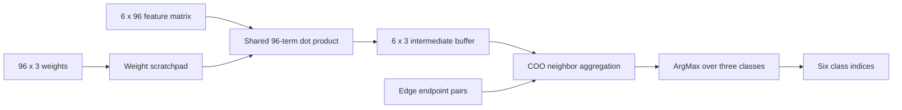

# GCN Accelerator for Node Classification

A SystemVerilog graph convolutional network accelerator that classifies six nodes into three classes. The implementation combines dense feature transformation with sparse graph aggregation and was carried through ASAP7 synthesis and physical implementation to GDSII.

## Architecture

The transformation, aggregation, and ArgMax controllers sequence the computation. Register-based buffers retain intermediate results. A shared 96-term dot-product datapath is reused across feature rows and classes.

## Explore the RTL

| File | Function |
| --- | --- |
| [GCN.sv](rtl/GCN.sv) | Top-level datapath, aggregation, and ArgMax |
| [Transformation_FSM.sv](rtl/Transformation_FSM.sv) | Feature and weight read sequencing |
| [Scratch_Pad.sv](rtl/Scratch_Pad.sv) | 96-element weight storage |
| [Matrix_FM_WM_Memory.sv](rtl/Matrix_FM_WM_Memory.sv) | Transformation results |
| [Matrix_FM_WM_ADJ_Memory.sv](rtl/Matrix_FM_WM_ADJ_Memory.sv) | Aggregation results |
| [GCN_TB.sv](rtl/GCN_TB.sv) | Original functional testbench |

## Recorded implementation results

| Check | Result | Evidence |
| --- | --- | --- |
| Synthesis clock constraint | 2 ns | [SDC](results/clock_constraints.sdc) |
| Post-route setup WNS | +0.530 ns, zero violating paths | [Setup summary](results/postroute_setup.summary) |
| Post-route hold WNS | +0.002 ns, zero violating paths | [Hold summary](results/postroute_hold.summary) |
| Post-synthesis output check | Six golden outputs matched | [Simulation log](results/synthesis_simulation.log) |
| Post-route output check | Six golden outputs matched | [Simulation log](results/postroute_simulation.log) |

The supplied golden class sequence is `[0, 0, 0, 1, 1, 2]`. The recorded flow used ModelSim, Synopsys Design Compiler, and Cadence Innovus for synthesis, floorplanning, placement, clock-tree synthesis, routing, timing optimization, and GDSII export.

## Reproducing the flow

The archived RTL testbench expects feature, weight, COO, and golden-output data files that are absent from the supplied archive. A complete replay requires those fixtures, the matching simulation models, and the relevant EDA environment. The saved simulation logs reference testbench variants and clock settings that differ from the available RTL testbench. Consequently, the log completion timestamps are not presented as measured inference latency. This portfolio export did not rerun the EDA tools.

ASAP7 LEF/Liberty files and proprietary EDA installations must be obtained separately. The original implementation archive and project reports document additional stages. The saved Calibre screenshots do not establish independent clean DRC/LVS signoff, so this repository presents the recorded timing and functional checks with their stated scope.
